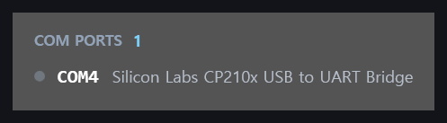
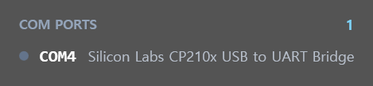
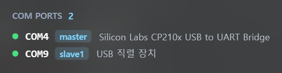
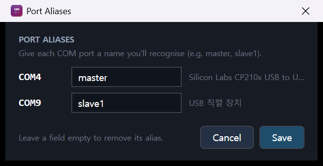
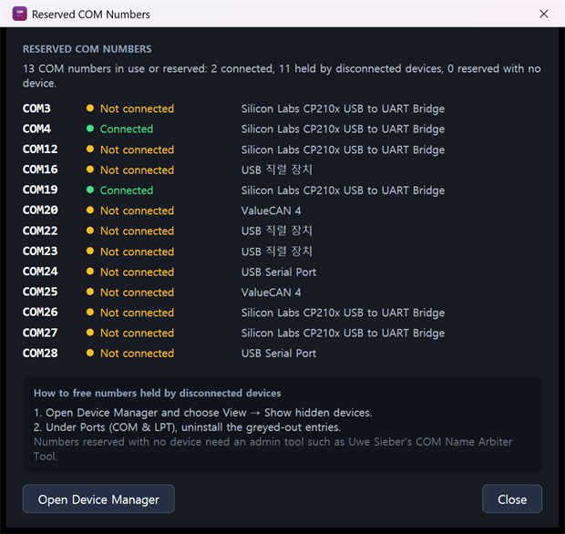

# ComportMonitor

**한국어** · [English](README.en.md)

Windows 바탕화면에 항상 떠 있는 **COM 포트 모니터 위젯**입니다. 장치 관리자를 열지 않고도 어떤 시리얼 포트가 연결되어 있는지, 어떤 포트를 다른 프로그램이 쓰고 있는지 실시간으로 보여줍니다. ESP32 등 임베디드 보드를 자주 꽂았다 뽑는 개발 환경을 위해 만들었습니다.



> 다른 프로그램이 포트를 점유하면 점이 초록으로 바뀌고, 놓으면 회색으로 돌아옵니다.

| 기본 (아크릴 블러) | 틴트 최대 (거의 불투명) |
|---|---|
|  |  |

## 기능

- **실시간 목록 갱신** — USB 장치를 꽂고 뽑는 순간 즉시 반영 (`WM_DEVICECHANGE` 이벤트 방식, 폴링 없음)
- **연결/해제 하이라이트** — 새 포트는 🟠 주황, 사라진 포트는 🔴 빨간 취소선으로 4초간 표시
- **포트 점유 표시** — 다른 프로그램(터미널, 플래셔 등)이 사용 중인 포트는 🟢 초록 점으로 표시. 툴팁과 포트 메뉴에 `In use by UartTerminal (PID 5376)`처럼 점유한 프로그램 이름도 표시 (3초 주기, 우클릭 메뉴에서 끄기 가능)
- **포트 별칭** — 포트마다 `master`, `slave1` 같은 이름을 붙여 구분 (아래 참고)
- **포트 이름 복사 · 터미널로 열기** — 포트를 클릭해 `COM4`를 클립보드로 복사하거나 PuTTY·Tera Term으로 바로 열기
- **COM 번호 변경** — 포트를 클릭해 바로 Windows 장치 속성 창을 열어 번호 변경 (관리자 권한 불필요)
- **예약된 COM 번호 보기** — 연결되지 않은 장치가 붙잡고 있는 번호를 보여 주고 정리 방법을 안내 (읽기 전용)
- **장치 정보 표시** — 장치 관리자와 동일한 친화명 (예: `Silicon Labs CP210x USB to UART Bridge`). 툴팁에서 `VID 10C4 · PID EA60 · S/N 0002`처럼 정리된 VID/PID·시리얼 번호 확인
- **연결·해제 알림** — 포트가 생기거나 사라지면 Windows 알림으로 표시 (옵션, 기본 꺼짐)
- **투명도 조절** — 진한 패널 ↔ 아크릴 블러 ↔ 유령 모드(글자까지 페이드)를 한 축으로 조절
- **가장자리 자석 스냅** — 드래그 중 모니터 가장자리에 자석처럼 정렬
- **모니터별 배율 대응** — 175 %와 100 %처럼 배율이 다른 모니터로 옮겨도 그 모니터 배율로 다시 그려 글자가 흐려지지 않음
- **자동 숨김** — 5분간 포트 변동이 없으면 숨겼다가, 변동이 생기면 다시 표시 (옵션). 숨은 동안에는 점유 메모리도 운영체제에 돌려줍니다
- **단축키 · 트레이 아이콘** — `Ctrl+Alt+Shift+C` 또는 트레이 아이콘 좌클릭으로 표시/숨김, 트레이 우클릭 메뉴로 종료
- **중복 실행 방지** — exe를 다시 실행하면 새 위젯을 띄우지 않고, 숨어 있던 기존 위젯을 다시 보여 줍니다
- **Windows 시작 시 실행** — 우클릭 메뉴에서 켜고 끔 (옵션, 관리자 권한 불필요)
- **위젯 UX** — 항상 위, 작업표시줄/Alt+Tab 숨김, 드래그 이동. 위치·설정은 바뀌는 즉시 저장되어 Windows를 그냥 꺼도 유지됩니다

## 포트별 설정 — 포트를 클릭하세요

목록에서 **포트를 클릭하면** 그 포트에 대한 메뉴가 열립니다.

```
COM4  (master)                     ← 어떤 포트인지 표시
In use by UartTerminal (PID 5376)  ← (사용 중일 때만) 점유한 프로그램
─────────────────
Copy "COM4"                        ← 포트 이름을 클립보드로 복사
Open in terminal                   ← 터미널 프로그램으로 바로 열기
─────────────────
Set alias...                       ← 이 포트의 별칭 지정
Remove alias                       ← (별칭이 있을 때만)
Change COM number...               ← 이 포트의 번호 변경
```

행 위에 마우스를 올리면 밝아져서 클릭할 수 있다는 걸 알 수 있고, 그대로 **끌면 창 이동**입니다(기존과 동일).

### 터미널로 열기

**Open in terminal**은 설치된 터미널을 PuTTY → Tera Term 순서로 찾아 115200 bps로 엽니다.

- 다른 프로그램이나 속도를 쓰려면 우클릭 → **Terminal command...** 에서 명령을 지정합니다
- 명령 안의 `{port}`는 `COM4`, `{num}`은 `4`로 바뀝니다
- 예: `"C:\Program Files\PuTTY\putty.exe" -serial {port} -sercfg 921600,8,n,1,N`
- 입력란을 비우고 저장하면 다시 자동 감지를 씁니다

### 별칭

COM 번호만으로는 어떤 보드인지 헷갈릴 때, 포트마다 원하는 이름을 붙일 수 있습니다.





- 별칭은 **COM 번호에 매칭**되어 저장됩니다 — 보드를 뽑았다 다시 꽂거나 PC를 재부팅해도 유지됩니다
- 지금 연결되지 않은 포트(`(not connected)`)의 별칭도 미리 지정하거나 지울 수 있습니다
- 입력란을 비우고 저장하면 해당 별칭이 삭제됩니다
- 우클릭 → **Set aliases...** 로 전체 목록을 한 번에 편집할 수도 있고, **Show aliases** 로 표시를 켜고 끕니다

### COM 번호 변경

**Change COM number...** 를 고르면 해당 장치의 Windows 속성 창이 바로 열립니다. 거기서 `포트 설정 → 고급 → COM 포트 번호`로 변경하면 됩니다 — 장치 관리자를 열어 목록을 뒤질 필요가 없습니다.

- 레지스트리를 직접 건드리지 않고 Windows에 맡기므로 **관리자 권한이 필요 없습니다**
- 번호를 바꾸면 그 포트의 **별칭도 새 번호로 자동으로 따라갑니다**

### 예약된 COM 번호

새 보드를 꽂을 때마다 COM 번호가 계속 올라간다면, 예전에 꽂았던 장치가 번호를 붙잡고 있는 경우가 많습니다. 우클릭 → **Reserved COM numbers...** 를 고르면 Windows가 기억하는 번호를 한눈에 볼 수 있습니다.



- `Connected`: 지금 연결된 장치
- `Not connected`: 연결되지 않은 장치가 번호를 붙잡고 있음
- `Reserved, no device`: 장치 없이 번호만 예약됨
- 장치 관리자의 `숨겨진 장치 표시`로 정리하는 방법도 안내합니다
- 목록은 읽기만 하고 레지스트리는 바꾸지 않습니다

## 조작법

| 동작 | 방법 |
|---|---|
| 포트별 메뉴 (복사 · 터미널 · 별칭 · COM 번호) | 목록에서 **포트를 클릭** |
| 표시 / 숨김 | **Ctrl+Alt+Shift+C** 또는 트레이 아이콘 좌클릭 |
| 이동 | 위젯을 마우스로 드래그 (가장자리 근처에서 자동 스냅) |
| 투명도 조절 | 위젯 위에서 **Ctrl + 마우스 휠** (위 = 진하게, 아래 = 투명하게) |
| 전체 별칭 편집 / 표시 전환 | **우클릭** → `Set aliases...` / `Show aliases` |
| 새로 고침 / 옵션 / 종료 | **우클릭** 컨텍스트 메뉴 |

설정은 바뀌는 즉시 `%APPDATA%\ComportMonitor\settings.json`에 저장됩니다.

## 다운로드

[Releases](https://github.com/firepooh/ComportMonitor/releases)에서 받을 수 있습니다:

| 파일 | 크기 | 조건 |
|---|---|---|
| `ComportMonitor-standalone.exe` | ~60MB | 없음 — 아무 PC에서나 바로 실행 |
| `ComportMonitor.exe` | ~1MB | [.NET 8 Desktop Runtime](https://dotnet.microsoft.com/download/dotnet/8.0) 필요 (없으면 실행 시 설치 안내가 뜸) |

## 요구 사항

- Windows 11 (아크릴 배경·둥근 모서리는 DWM 기능 사용)
- Windows 10처럼 아크릴을 지원하지 않는 환경에서는 어두운 단색 배경으로 표시합니다

## 빌드

```
dotnet build -c Release
```

Visual Studio 2022에서 `ComportMonitor.csproj`를 바로 열어도 됩니다.
실행 파일: `bin\Release\net8.0-windows\ComportMonitor.exe`

## 동작 원리

- **포트 열거**: WMI `Win32_PnPEntity`에서 Ports 클래스 GUID(`{4d36e978-e325-11ce-bfc1-08002be10318}`)로 필터링합니다. `Win32_SerialPort`는 USB CDC 장치(ESP32-S3 USB-JTAG 등)를 누락하므로 쓰지 않습니다.
- **점유 감지**: 액세스 권한 0의 `CreateFile` 프로브. 시리얼 드라이버는 단일 오픈만 허용하므로 권한 0으로도 점유가 정확히 판별되고, 포트를 초기화하지 않아 DTR/RTS 글리치(보드 리셋) 위험이 최소화됩니다.
- **점유 프로그램 찾기**: 시스템 핸들 목록(`NtQuerySystemInformation`)에서 시리얼 장치를 연 핸들을 찾아 프로그램 이름을 구합니다. 포트를 열지 않으므로 통신에 영향을 주지 않습니다. 관리자 권한으로 실행된 프로그램처럼 조회 권한이 없으면 이름 없이 `In use`로 표시됩니다.
- **반투명 창**: WPF `AllowsTransparency`는 모니터 DPI ≠ 시스템 DPI 환경에서 창 크기가 96DPI 기준으로 잘리는 버그가 있어 사용하지 않습니다. 대신 DWM 아크릴 백드롭(`DWMWA_SYSTEMBACKDROP_TYPE`)을 쓰고, 유령 모드는 수동 `WS_EX_LAYERED` + `SetLayeredWindowAttributes`로 구현했습니다 — WPF가 이 스타일을 강제로 벗겨내므로 `SetWindowSubclass`로 WPF 처리 직후 비트를 되살리는 우회가 들어 있습니다.

## 라이선스

[MIT](LICENSE)
